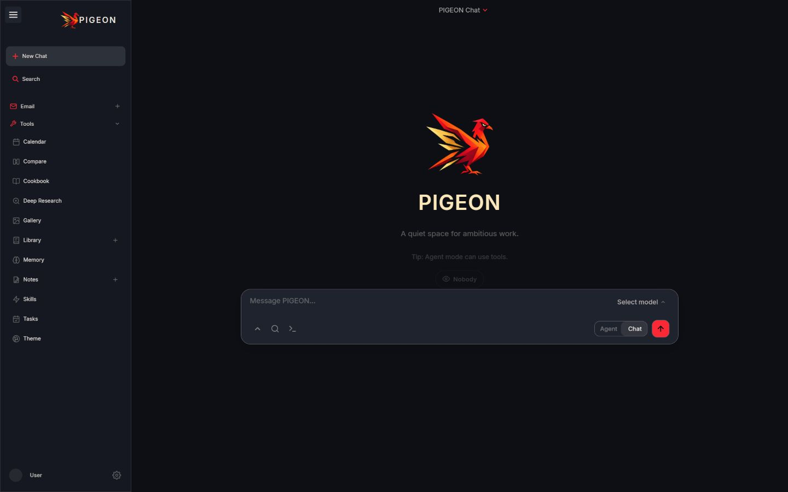

<p align="center"></p>
<h1 align="center">PIGEON</h1>
<p align="center">A quiet space for ambitious work.</p>
<p align="center">A self-hosted AI workspace for chat, agents, research, documents, and your daily tools.</p>
<p align="center"><a href="#getting-started">Getting started</a> · <a href="website/setup.md">Setup guide</a> · <a href="LICENSE">License</a></p>



## Your workspace, under your control

Bring local models and cloud providers into one place. Work across conversations, research, writing, and personal tools without handing over your workspace.

| Workspace | Capabilities |
| --- | --- |
| Chat and agents | Streaming conversations, model selection, tool approvals, MCP, skills, memory, voice, and uploads |
| Research and writing | Deep research, sources, document editing, version history, personal retrieval, and exports |
| Models | Side-by-side comparison, blind voting, hardware-aware recommendations, downloads, and serving |
| Daily tools | Email and contacts, notes, tasks, reminders, calendar, and gallery |
| Creative tools | Image editing with layers, masks, selections, adjustments, history, and exports |
| Personalization | PIGEON Midnight, additional themes, custom colors, font choices, density, and keyboard shortcuts |

## Getting started

```sh
git clone https://github.com/Yumekaz/Pigeon.git
cd Pigeon
```

On Windows, use the native launcher:

```powershell
powershell -ExecutionPolicy Bypass -File .\launch-windows.ps1
```

Install Git and Python 3.11+ first (the clean Windows check used Python 3.12).
The launcher prepares dependencies and starts the application at
`http://127.0.0.1:7000` by default. On the first interactive launch, choose your
admin username and password. For later launches, run the same command from this
folder and keep its terminal open; Ctrl+C stops the server. The launcher checks
Python dependencies on every run, so it may contact the package registry again.

No frontend build command is needed. Add your cloud provider or local-model
server in **Settings**. Semantic retrieval needs ChromaDB and embeddings;
web search needs a configured provider. The native launcher does not start
those companion services. Email, calendar sync and other integrations have
their own account/service requirements. Your credentials and data stay local
and are not included in a clone.

For other platforms and deployment options, see the [setup guide](website/setup.md). Container configurations retain compatible internal identifiers; release images are published separately from source changes.

## Development

The frontend uses HTML, CSS, and native JavaScript modules, served by FastAPI. The ordered legacy stylesheets are followed by `static/css/pigeon.css`; themes map shared presentation tokens onto existing preferences.

```sh
python -m pip install -r requirements-dev.txt
npm ci
npx playwright install chromium
python -m pytest
npm run test:photo-editor
```

Use an isolated data directory for tests. Windows runs should use UTF-8. See [test guidance](tests/README.md) for fixtures, focused runs, and external-service prerequisites.

See the [codebase hygiene and fresh-clone check](docs/PIGEON_CODEBASE_HYGIENE.md)
for clean Windows startup evidence and the remaining reliability improvements.

## Security

Keep `AUTH_ENABLED=true` for any network-accessible deployment. Keep `LOCALHOST_BYPASS=false` outside local development. Bind locally unless you deliberately configure network access. Keep credentials, databases, uploads, and runtime artifacts out of version control. See [SECURITY.md](SECURITY.md).

## License and acknowledgments

PIGEON is distributed under **AGPL-3.0-or-later**. Required source provenance, upstream acknowledgments, and third-party notices are preserved in [ACKNOWLEDGMENTS.md](ACKNOWLEDGMENTS.md), [LICENSE](LICENSE), and [licenses/](licenses/).
